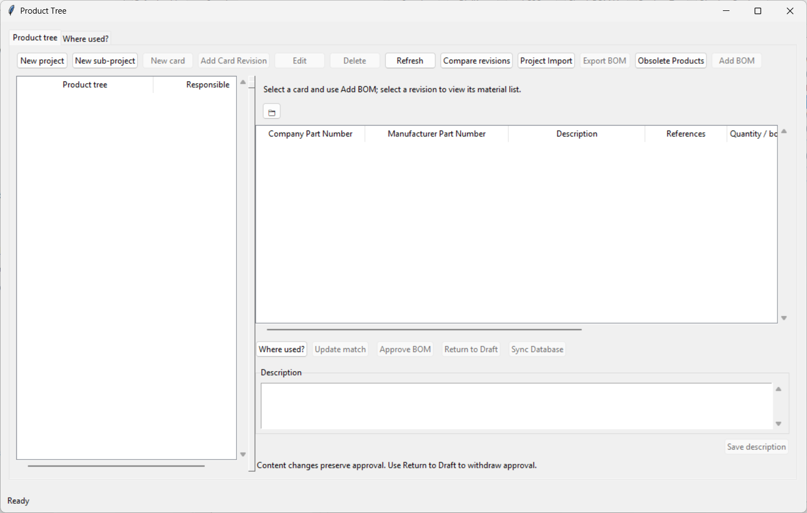
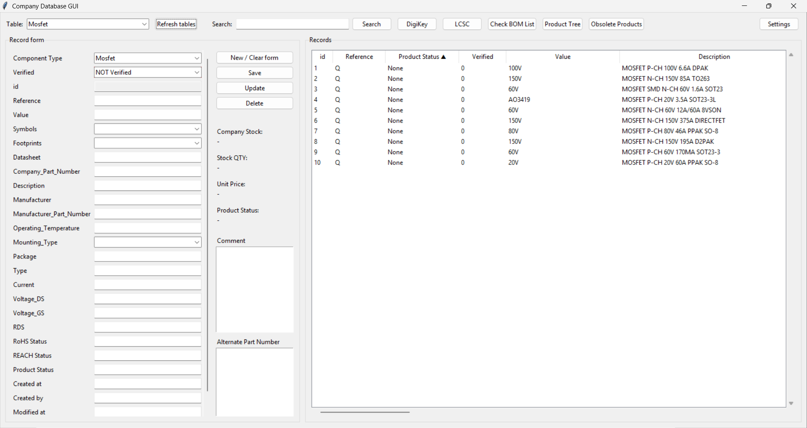
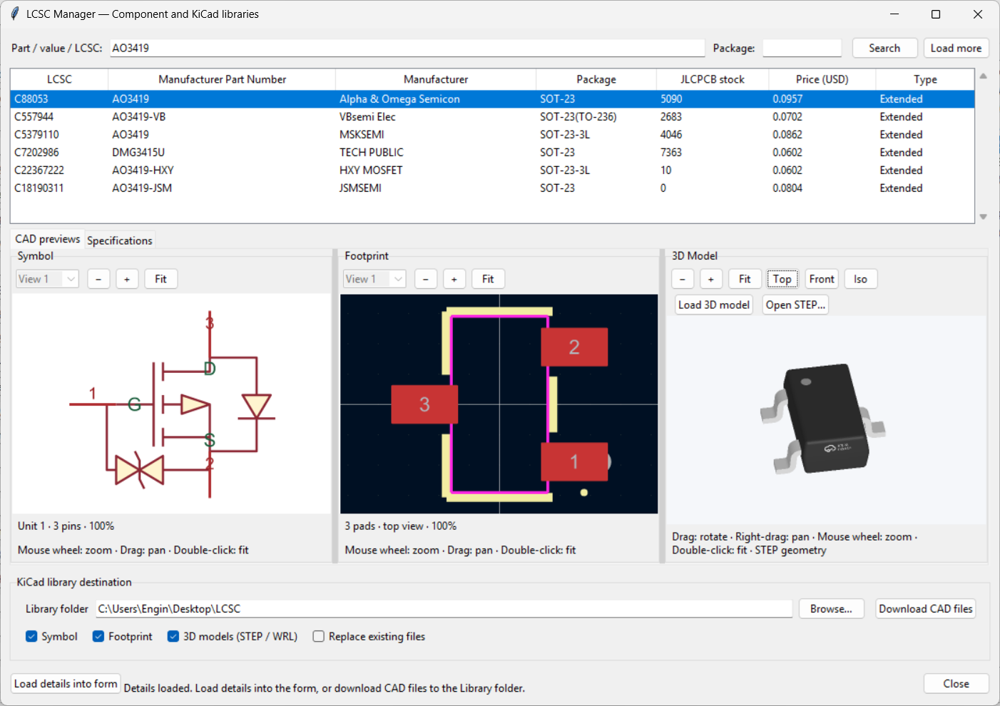

# KicadDB - KiCad Component & BOM Management System

A professional Python/Tkinter desktop application for managing KiCad components, Bill of Materials (BOM), and project hierarchies with integrated DigiKey/LCSC lookup capabilities.

## 🎯 Overview

KicadDB is a comprehensive component management system designed for electronics engineers and PCB designers using KiCad. It provides:

- **Hierarchical Project Management** — Projects → Subprojects → Cards (PCBs) → Revisions
- **BOM Management** — Import, edit, compare, and export BOMs with full revision history
- **Component Database** — Local SQLite database with manufacturer parts, stock tracking, and verification
- **Supplier Integration** — DigiKey API for pricing/stock, LCSC/JLCPCB for assembly parts
- **Footprint & Symbol Management** — KiCad library integration with preview and suggestions
- **Audit & Compliance** — Full change logging, approval workflows, and permissions

---

## 🏗️ Architecture

```
┌─────────────────────────────────────────────────────────────┐
│                     KicadDB Application                      │
├─────────────────┬─────────────────┬─────────────────────────┤
│  Product Tree   │  Component DB   │  Supplier APIs          │
│  (UI)           │  (SQLite)       │  - DigiKey              │
│                 │                 │  - LCSC/JLCPCB          │
├─────────────────┼─────────────────┼─────────────────────────┤
│  BOM Editor     │  Project Import │  Export & Reports       │
│  & Comparator   │  (Excel)        │  - Excel/CSV            │
│                 │                 │  - Gerber/Assembly      │
└─────────────────┴─────────────────┴─────────────────────────┘
```

---

## ✨ Key Features

### 📁 Project Hierarchy
- **Projects** → **Subprojects** → **Cards (PCBs)** → **Revisions**
- Unique codes per parent level
- Shared revisions across projects
- Current/Historical revision tracking

### 📦 BOM Management
| Feature | Description |
|---------|-------------|
| **Import** | From Excel templates with column mapping |
| **Edit** | Inline row editor with component matching |
| **Compare** | Side-by-side revision diff (add/change/remove) |
| **Sync** | Auto-fill CMP numbers from database/MPN |
| **Approve** | Role-based approval workflow (Admin/User) |
| **Export** | Consolidated project BOMs with quantities |

### 🔧 Component Database
- **Local SQLite** — No external server required
- **Multi-table** — Resistor, Capacitor, IC, MCU, Mosfet, etc.
- **CMP Numbers** — Company Part Numbers with aliases
- **Stock Tracking** — Real-time inventory levels
- **Verification** — Part verification status & audit trail

### 🌐 Supplier Integration
- **DigiKey API** — Pricing, stock, datasheets, parametric search
- **LCSC/JLCPCB** — Assembly parts library, footprint/symbol download
- **Circuit Breaker** — Automatic supplier failure handling

### 👣 Footprint & Symbol Tools
- **LCSC Manager** — Browse, convert, and register LCSC parts
- **Footprint Preview** — 2D SVG rendering with KiCad palette
- **3D STEP Preview** — Rotate/pan/zoom with color preservation
- **Smart Suggestions** — Package code → footprint mapping

---

## 🚀 Quick Start

### Prerequisites
- Python 3.11+
- KiCad 7.0+ (for library integration)
- DigiKey API credentials (optional, for pricing/stock)

### Installation

```powershell
# Clone repository
git clone https://github.com/e135193/kicaddb.git
cd kicaddb

# Create virtual environment
python -m venv .venv
.\.venv\Scripts\Activate.ps1

# Install dependencies
python -m pip install -r requirements.txt

# Run application
python Company_Kicad_DB.py
```

### Building Executable

```powershell
python -m PyInstaller Company_Kicad_DB.spec
# Output: dist/Company_Kicad_DB.exe
```

---

## 📖 Usage Guide

### 1. First Launch
- Database (`KicadDB.sqlite`) auto-creates on first run
- Default admin user: `admin` / `123456` (change on first login)
- Configure DigiKey API keys in **Settings → API Keys**

### 2. Creating a Project
```
Product Tree → Right-click → New Project
  → Enter Project Code (e.g., "PRJ-001")
  → Add Subprojects, Cards, Revisions
```

### 3. Importing a BOM
```
Select Revision → Add BOM → Choose Excel file
  → Map columns (CMP, MPN, Qty, Ref, etc.)
  → Review matches → Import
```

### 4. Syncing CMP Numbers
```
Select Revision/Project → Sync Database
  → Fills missing CMP from live database matches
  → Falls back to unique MPN + Manufacturer
  → Reports ambiguous/skipped rows
```

### 5. Exporting for Manufacturing
```
Export → Choose scope (Project/Card/Revision)
  → Generates consolidated Excel with:
    - CMP/MPN/Manufacturer/Description/Qty
    - Board quantities multiplied
    - Stock levels
    - Traceability to source revisions
```

---

## 🖼️ Screenshots

### Main Window - Product Tree

*Hierarchical project browser with drag-and-drop reorganization*

### BOM Editor

*Inline editing with component matching and match repair*

### LCSC Manager

*Browse LCSC parts, preview symbols/footprints/3D, convert to KiCad*

---

## 🛠️ Configuration

### Settings File (`settings.json`)
```json
{
  "database_path": "KicadDB.sqlite",
  "symbol_library_dir": "Symbols",
  "api_keys_path": "API-Keys.json",
  "db_backup_keep": 10,
  "digikey_client_id": "your_client_id",
  "digikey_client_secret": "your_client_secret"
}
```

### API Keys (`API-Keys.json`)
```json
{
  "digikey": [
    {
      "client_id": "xxx",
      "client_secret": "yyy",
      "name": "Primary"
    }
  ]
}
```

---

## 🧪 Testing

```powershell
# Run all tests
python -m unittest discover -s tests -v

# Run specific test module
python -m unittest tests.test_product_tree -v

# Smoke test with real data
python run_smoke.py
```

---

## 📦 Project Structure

```
kicaddb/
├── Company_Kicad_DB.py        # Main application entry point
├── config.py                  # Path resolution & constants
├── db.py                      # Database core (CRUD, audit, schema)
├── product_tree.py            # Project/BOM logic & permissions
├── product_tree_export.py     # Excel/CSV export & consolidation
├── project_tree_import.py     # Excel workbook import
├── project_overview.py        # Multi-project material summary
├── local_stock.py             # Local SQLite stock lookup
├── bom_stock.py               # BOM stock enrichment
├── db_backup.py               # Daily SQLite online backup
├── digikey_api.py             # DigiKey API client
├── lcsc_*.py                  # LCSC/JLCPCB integration
├── footprint_suggestions.py   # Package→footprint mapping
├── step_*.py                  # STEP 3D preview
├── users.py                   # Authentication & permissions
├── api_keys.py                # Encrypted API key storage
├── log_history.py             # Change log viewer
├── ui/                        # Tkinter UI components
│   ├── product_tree_window.py
│   ├── bom_edit_window.py
│   ├── lcsc_manager_window.py
│   ├── footprint_window.py
│   ├── step_preview.py
│   ├── cad_preview.py
│   ├── library_preview.py
│   ├── revision_compare_window.py
│   ├── project_overview_panel.py
│   ├── obsolete_products_window.py
│   ├── settings_window.py
│   ├── login_window.py
│   └── widgets.py
├── third_party/
│   └── lcsc_manager/          # Pinned LCSC converter
├── templates/
│   ├── BOM_Template.xlsx
│   └── Project_Import_Template.xlsx
└── tests/                     # Unit tests (unittest)
```

---

## 🔐 Security & Permissions

| Role | Capabilities |
|------|--------------|
| **Admin** | Full access: approve BOMs, delete projects, manage users, verify parts |
| **User** | Create/edit drafts, import BOMs, sync database, view reports |

- Passwords: PBKDF2-HMAC-SHA256 with per-user salt
- API Keys: Encrypted with Windows DPAPI
- Audit Log: All changes recorded with user/timestamp
- Reset Tokens: 15-min single-use, TLS email delivery

---

## 📋 Requirements

```
pandas>=2.0
openpyxl>=3.1
requests>=2.31
digikey-api>=1.2
cadquery-ocp>=7.6  # for STEP preview
resvg-py>=0.14     # for SVG footprint rendering
Pillow>=10.0       # image processing
```

---

## 🤝 Contributing

1. Fork the repository
2. Create feature branch (`git checkout -b feature/amazing-feature`)
3. Run tests (`python -m unittest discover -s tests -v`)
4. Commit changes (`git commit -m 'Add amazing feature'`)
5. Push to branch (`git push origin feature/amazing-feature`)
6. Open Pull Request

---

## 📄 License

This project is licensed under the MIT License - see [LICENSE](LICENSE) for details.

---

## 🙏 Acknowledgments

- **KiCad** — Open source EDA suite
- **DigiKey** — Component distributor API
- **LCSC/JLCPCB** — Assembly parts & PCB fabrication
- **EasyEDA2KiCad** — LCSC→KiCad conversion library
- **cadquery-ocp** — STEP file processing
- **resvg** — SVG rendering

---

<div align="center">
  
  <br/>
  <strong>KicadDB</strong> — Professional KiCad Component Management
</div>